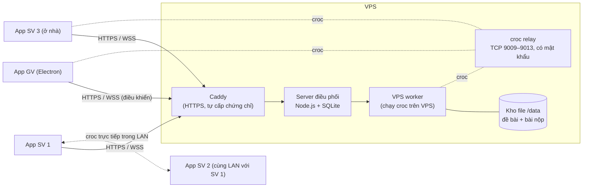
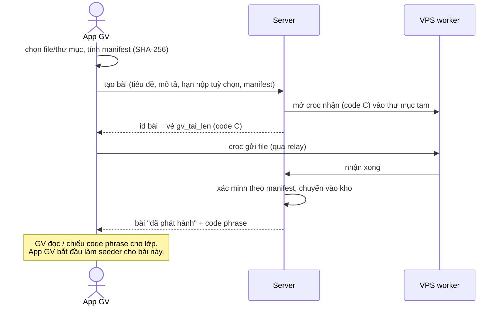
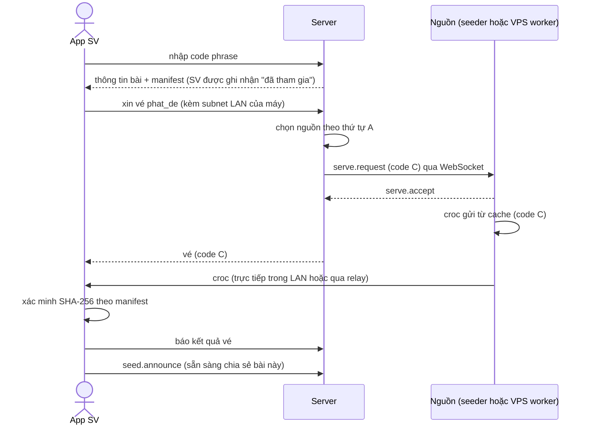
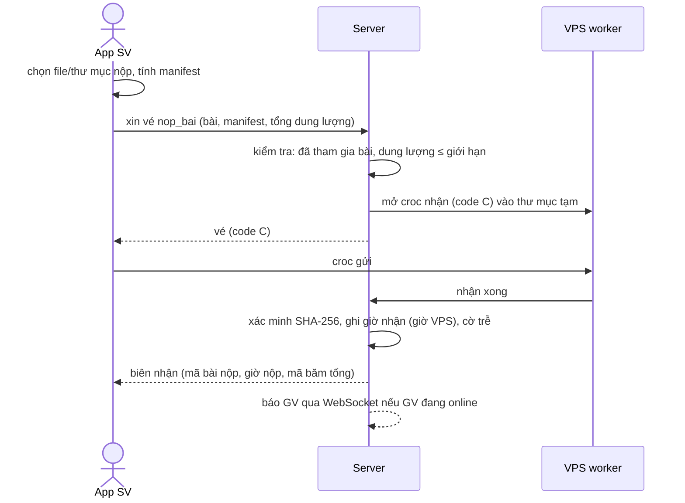

# Thiết kế hệ thống — Ứng dụng Giao–Nộp bài tập dùng croc

> Ngày: 2026-11-11 · Trạng thái: **Đã duyệt (2026-11-11)** · Tên dự án tạm: `croc-classroom`
>
> Quy ước đánh dấu: **[Bạn chốt]** = quyết định của người dùng trong buổi trao đổi ·
> **[Claude đề xuất]** = Claude tự điền, người dùng có thể sửa.
>
> Viết tắt: GV = giảng viên, SV = sinh viên.

---

## 1. Mục đích

Ứng dụng desktop (Electron) giúp **một giảng viên** giao file bài tập cho sinh viên và nhận bài nộp, dùng
**[croc](https://github.com/schollz/croc)** làm lớp truyền file (mã hoá đầu–cuối bằng PAKE, đi qua relay
hoặc truyền trực tiếp trong mạng LAN).

Yêu cầu gốc:

1. GV giao bài bằng **một code phrase** dùng chung cho nhiều SV (1–n). **[Bạn chốt]**
2. SV nhận được file trước có thể **chia sẻ lại** cho SV khác. **[Bạn chốt]**

Chốt thêm trong quá trình trao đổi:

| Chủ đề | Quyết định |
|---|---|
| Môi trường mạng | SV có thể ở cùng LAN với GV (trên lớp) **hoặc** ở nhà qua Internet. **[Bạn chốt]** |
| Hạ tầng | Dùng **một VPS nhỏ** chạy relay croc riêng. **[Bạn chốt]** |
| Nộp bài | Chỉ cần SV nộp – GV nhận. Không chấm điểm, không phản hồi. **[Bạn chốt]** |
| Số giảng viên | Chỉ **một** giảng viên. **[Bạn chốt]** |
| Đăng nhập | Có đăng nhập: **giảng viên (admin)** và **sinh viên (client)**. **[Bạn chốt]** |
| Code phrase | **Vẫn giữ** bước GV đưa code phrase, SV nhập code để nhận bài (dù đã đăng nhập). **[Bạn chốt]** |
| Chọn nguồn phát | **Phương án A**: ưu tiên bạn cùng LAN → VPS → bạn qua Internet. **[Bạn chốt]** |
| Hệ điều hành | Windows, macOS, Linux ngay từ bản đầu (cần một máy Mac để build bản macOS). **[Mặc định Claude đề xuất, bạn duyệt]** |
| Tên miền VPS | Dùng tên miền riêng; nếu chưa có thì dùng tên miền miễn phí (ví dụ DuckDNS). **[Mặc định Claude đề xuất, bạn duyệt]** |

## 2. Mục tiêu, không làm, chống mục tiêu

**Mục tiêu**

- SV nhập một code là nhận được **đúng** bộ file GV giao, dù đang ở lớp hay ở nhà.
- Trên lớp (cùng LAN), phần lớn SV nhận file từ máy bên cạnh, không phải kéo từ Internet.
- GV có thể tắt máy sau khi giao bài; SV vẫn nhận đề và nộp bài được.
- GV mở app là có bài nộp mới nhất của từng SV, kèm giờ nộp đáng tin (giờ VPS) và cờ "trễ hạn".

**Không làm (bản đầu)**

- Chấm điểm, nhận xét, gửi phản hồi cho SV.
- Nhiều giảng viên, phân quyền nhiều cấp.
- Quản lý lớp học / thời khoá biểu; SV tự đăng ký tài khoản.
- Khoá nhận bài sau hạn (nộp trễ vẫn nhận, chỉ đánh dấu).
- Sửa file của bài đã phát hành (muốn đổi thì tạo bài mới).
- Chia sẻ lại **bài nộp** giữa SV (bài nộp là riêng tư, chỉ đi SV → VPS → GV).
- Tự cập nhật app, ký số bộ cài, app di động, giao diện web.
- Mã hoá bài nộp "chỉ GV đọc được" khi lưu trên VPS.

**Chống mục tiêu** — chạy được nhưng vẫn coi là thất bại nếu:

- SV nhận phải file **bị sửa hoặc giả** mà app không phát hiện.
- SV xem hoặc tải được bài nộp của người khác.
- Một SV nộp bài dưới tên SV khác.
- Người ngoài dùng tự do relay riêng.
- SV ở nhà chỉ nhận được bài khi máy GV đang bật.

## 3. Ràng buộc kỹ thuật của croc

Kiểm chứng với **croc 10.7.0** trên máy phát triển (relay cục bộ có mật khẩu, 1 người gửi + 2 người nhận):

| Hành vi của croc | Hệ quả cho thiết kế |
|---|---|
| Mỗi code chỉ ghép **1 người gửi ↔ 1 người nhận**. Người nhận thứ hai dùng cùng code **bị treo** ở bước "securing channel", không báo lỗi. *(đã thử)* | Code phrase của GV **không** phải code croc. Mỗi lượt truyền dùng một **code croc dùng một lần** do server cấp. Mọi tiến trình croc phải có **timeout**. |
| Gửi xong một lượt thì tiến trình `croc send` kết thúc. *(đã thử)* | Mỗi lượt phát (từ VPS hoặc từ seeder) là một tiến trình croc mới. |
| Croc **không xuyên NAT**: hai máy khác mạng thì dữ liệu luôn chạy qua relay. | Qua Internet, P2P không tiết kiệm băng thông VPS (dữ liệu vào rồi ra relay). Đây là lý do chọn phương án A. |
| Người gửi mặc định bật relay cục bộ + multicast để người nhận cùng LAN kết nối trực tiếp. | Chỉ cần ghép hai máy cùng LAN là có truyền trực tiếp. Nếu mạng chặn multicast (Wi-Fi cô lập client) thì croc tự đi qua relay VPS — vẫn đúng, chỉ chậm hơn. |
| Relay chạy với mật khẩu: `croc --pass <pw> relay`; client dùng `--pass <pw> --relay <host>:9009`. *(đã thử)* | Relay riêng đặt mật khẩu. App nhận địa chỉ + mật khẩu relay từ server sau khi đăng nhập, không nhúng cứng trong bộ cài. |
| CLI in tiến trình dạng thanh progress cho người đọc (ký tự `\r`), không có đầu ra JSON. *(đã thử)* | Bọc croc trong **một module riêng** (`croc-engine`) chịu trách nhiệm chạy và đọc đầu ra croc. Phần còn lại của hệ thống không đụng tới chuỗi đầu ra croc. |
| Relay dùng cổng TCP 9009–9013 (mặc định). | Mở các cổng này trên tường lửa VPS. |
| Truyền code ở dạng tham số dòng lệnh vẫn chạy trên Linux ở bản 10.7.0. *(đã thử)* | Builder vẫn nên ưu tiên biến môi trường `CROC_SECRET` nếu croc hỗ trợ, để code không lộ trong danh sách tiến trình. |

## 4. Các phương án đã cân nhắc

### 4.1 Hạ tầng và cách chọn nguồn phát

| Phương án | Mô tả | Kết quả |
|---|---|---|
| Không VPS, máy GV điều phối bằng croc | App GV mở một "phòng sảnh" croc, phát vé lần lượt cho từng SV | **Loại**: GV phải bật máy suốt; không có chỗ cho đăng nhập và nộp bài khi GV tắt máy; sảnh xử lý tuần tự (~1–3 phút cho 60 SV). |
| VPS phát cho tất cả, không chia sẻ lại | Đơn giản nhất | **Loại**: trái yêu cầu 2. |
| **A. Bạn cùng LAN → VPS → bạn qua Internet** | Server ghép SV với máy cùng mạng nếu có, không thì VPS phát | **Chọn [Bạn chốt]**: nhanh nhất trên lớp, ít tốn băng thông VPS, ổn định khi ở nhà. Đổi lại: ở nhà gần như không có chia sẻ lại. |
| B. Bạn bè trước, VPS dự phòng | Luôn ưu tiên SV đã có file | **Không chọn**: qua Internet tốn gấp đôi băng thông VPS, phụ thuộc mạng nhà của bạn bè. |

### 4.2 Cách tích hợp croc **[Claude đề xuất]**

| Phương án | Kết quả |
|---|---|
| **Gọi croc CLI (bản đóng gói sẵn) qua module bọc `croc-engine`** | **Chọn**: nhanh làm, dùng đúng bản croc chính thức, dùng chung được cho app và server. |
| Chương trình Go riêng (sidecar) dùng thư viện croc, nói chuyện với app bằng JSON | Để dành: chuyển sang khi việc đọc đầu ra CLI trở nên mong manh. `croc-engine` giữ giao diện ổn định để đổi bên trong không ảnh hưởng chỗ khác. |
| Tự viết lại giao thức croc bằng Node.js | **Loại**: quá tốn công, dễ sai bảo mật. |

## 5. Kiến trúc tổng quan



Hai kênh tách biệt:

- **Kênh điều khiển** (HTTPS + WebSocket qua Caddy): đăng nhập, code phrase, manifest, vé, trạng thái. **Không** chở nội dung file.
- **Kênh dữ liệu** (croc): mọi nội dung file, mã hoá đầu–cuối cho từng lượt.

Thành phần:

| Thành phần | Vai trò |
|---|---|
| **App desktop** (Electron) | Một app cho cả hai vai trò; sau khi đăng nhập hiện giao diện GV hoặc SV. Chứa `croc-engine`, tác tử chia sẻ lại (seeder), cache chia sẻ. |
| **Server điều phối** | Tài khoản, bài tập, code phrase, manifest, cấp vé, chọn nguồn (phương án A), theo dõi seeder đang online, bài nộp. |
| **VPS worker** (module trong server) | Chạy croc trên VPS để: nhận đề từ GV, phát đề cho SV, nhận bài nộp, phát bài nộp cho GV. |
| **croc relay** | Relay riêng có mật khẩu, chỉ app của hệ thống dùng. |
| **Kho file** | Thư mục `/data` trên VPS: bản đề đã xác minh, bài nộp mới nhất của mỗi SV, CSDL SQLite. |
| **`croc-engine`** | Gói dùng chung bọc croc CLI: gửi, nhận, tiến trình, huỷ, timeout. |
| **`shared`** | Gói dùng chung: kiểu dữ liệu, hợp đồng API và WebSocket, manifest, sinh code phrase. |

## 6. Khái niệm

- **Code phrase (mã bài)** — chuỗi dễ đọc GV đưa cho lớp, ví dụ `sao-mai-xanh-42`. Ánh xạ tới một bài tập trên server. Không dùng trực tiếp với croc.
- **Manifest** — danh sách file của một bộ file (đường dẫn tương đối, kích thước, SHA-256). Server giữ manifest của đề và của từng bài nộp; đây là **nguồn sự thật** để xác minh file nhận được.
- **Vé (ticket)** — một lượt truyền croc: loại vé, bên gửi, bên nhận, code croc dùng một lần (ngẫu nhiên ≥ 128 bit), hạn dùng.
  Loại vé: `gv_tai_len` (GV → VPS), `phat_de` (nguồn → SV), `nop_bai` (SV → VPS), `gv_thu_bai` (VPS → GV).
- **Nguồn** — bên gửi trong vé `phat_de`: VPS, hoặc một máy người dùng đã có bản đề đã xác minh (gọi là **seeder**; GV cũng là seeder).
- **Cache chia sẻ** — bản sao chỉ-đọc của đề nằm trong thư mục dữ liệu của app, dùng để chia sẻ lại. Tách khỏi bản SV mở ra làm bài, để SV sửa file không làm hỏng việc chia sẻ. **[Claude đề xuất]**
- **Gốc bộ file (payload)** — mọi lượt truyền đều gửi **một thư mục gốc** theo cùng một quy ước ở mọi nơi (app GV, seeder, VPS worker, app SV); đường dẫn trong manifest tính từ gốc này. Quy ước cụ thể do `croc-engine` định nghĩa một lần. **[Claude đề xuất]**

## 7. Luồng nghiệp vụ

### 7.1 Cài đặt (một lần)

1. Thuê VPS và một **tên miền** trỏ về VPS (Caddy cần tên miền để cấp chứng chỉ HTTPS; tên miền miễn phí kiểu DuckDNS cũng được).
2. Chép thư mục `deploy/`, điền `.env` (tên miền, mật khẩu relay, các giới hạn), chạy `docker compose up -d` (Caddy + server + relay).
3. Tạo tài khoản GV bằng lệnh CLI của server (chạy trong container).
4. Build app với **địa chỉ server mặc định**; màn hình đăng nhập vẫn cho sửa địa chỉ. **[Claude đề xuất]**

### 7.2 Quản lý sinh viên

1. GV nhập file CSV `mssv,ho_ten[,lop]` trong app. Cột `lop` chỉ để hiển thị và lọc. **[Claude đề xuất]**
2. Server tạo tài khoản SV ở trạng thái chưa kích hoạt, sinh **mã kích hoạt** ngẫu nhiên (hạn 14 ngày), trả về danh sách để GV xuất CSV / in phát cho SV. **[Claude đề xuất]**
3. SV lần đầu mở app: nhập MSSV + mã kích hoạt + tự đặt mật khẩu → tài khoản được kích hoạt, mã hết hiệu lực.
4. SV quên mật khẩu: GV bấm "Cấp lại mã kích hoạt" cho SV đó.
5. GV có thể vô hiệu hoá tài khoản SV.

### 7.3 Giao bài



- Code phrase **chỉ dùng được sau khi VPS có bản đề đầy đủ và đúng**, để luôn có nguồn dự phòng. Đánh đổi: trên lớp phải chờ GV tải đề lên VPS xong. **[Claude đề xuất]**
- Tải lên lỗi giữa chừng → bài giữ trạng thái `dang_tai_len`, app GV xin vé mới và gửi lại.
- Lúc tạo bài, app GV chép bộ file vào cache chia sẻ của chính nó để làm seeder. **[Claude đề xuất]**
- Sau khi phát hành, file của bài không sửa được. Tiêu đề, mô tả, hạn nộp thì sửa được. **[Claude đề xuất]**
- GV xoá bài ⇒ xoá đề và toàn bộ bài nộp của bài đó trên VPS (để giải phóng dung lượng). **[Claude đề xuất]**

### 7.4 Nhận bài — phương án A



**Thuật toán chọn nguồn** (chạy mỗi lần SV xin vé):

1. Seeder đang online, đang rảnh, có bản đã xác minh, **cùng IP công khai VÀ cùng subnet LAN** với SV → chọn seeder ít được dùng gần đây nhất.
   (Phải so cả subnet: nhiều nhà mạng dùng CGNAT nên hai nhà khác nhau có thể chung IP công khai.)
2. Không có → **VPS**, nếu số phiên croc VPS đang chạy dưới giới hạn (mặc định 10).
3. Không có → seeder rảnh bất kỳ qua Internet.
4. Không có → **xếp hàng** theo thứ tự đến trước; server đẩy vé qua WebSocket khi có nguồn rảnh.

Seeder gửi `serve.accept` trong 5 giây, nếu không server chọn nguồn khác. **[Claude đề xuất]**

**Quy tắc chia sẻ lại** **[Claude đề xuất]**

- Mỗi seeder phục vụ tối đa **1 lượt cùng lúc** (cấu hình được trong app).
- Chia sẻ lại **bật mặc định**; SV tắt được trong Cài đặt.
- Chỉ chia sẻ khi app đang chạy (kể cả khi thu nhỏ xuống khay hệ thống).
- Server **không bao giờ** gửi IP của máy này cho máy khác; hai bên chỉ biết nhau qua code croc.
- Mỗi lần kết nối lại, app gửi `seed.announce` cho mọi bài đang có trong cache.
- Cache của một bài được giữ đến khi bài bị xoá trên server hoặc SV tự xoá trong Cài đặt.
- Bản để SV làm bài được chép vào thư mục SV chọn, mặc định `<Tài liệu>/croc-classroom/<tên bài>/`.

**Xử lý lỗi**

- Nhận vào **thư mục tạm**; chỉ chuyển sang thư mục của SV và cache chia sẻ sau khi xác minh xong.
- Vé có hạn: không xong trong `max(2 phút, dung lượng / 100 KB/s)` → hai bên dừng croc, SV tự xin vé mới. **[Claude đề xuất]**
- Một nguồn hỏng 2 lần liên tiếp → tạm loại khỏi danh sách nguồn của bài đó.
- Sai SHA-256 → xoá bản tạm, báo server; nguồn đó bị loại vĩnh viễn khỏi bài đó; SV xin vé mới.

### 7.5 Nộp bài



- **Giờ nộp** = lúc VPS nhận xong và xác minh xong. **[Claude đề xuất]**
- **Trễ** = bài có hạn nộp và giờ nộp > hạn. Vẫn nhận, chỉ đánh dấu.
- **Nộp lại** được nhiều lần; bản mới thay bản cũ **sau khi** bản mới xác minh xong; VPS chỉ giữ bản mới nhất. **[Claude đề xuất]**
- Giới hạn dung lượng bài nộp mặc định **200 MB** (cấu hình được). Worker theo dõi thư mục tạm, vượt giới hạn thì dừng croc. **[Claude đề xuất]**
- SV chỉ xem được biên nhận của chính mình.

### 7.6 Giảng viên nhận bài nộp

- Khi app GV mở, và mỗi khi có sự kiện "có bài nộp mới", app tự xin vé `gv_thu_bai` và tải các bài chưa tải về:
  `<thư mục GV chọn>/<tên bài>/<MSSV>_<HoTenKhongDau>/`.
- Bản nộp mới hơn → thay thư mục cũ trên máy GV. **[Claude đề xuất]**
- Xác minh SHA-256 rồi báo server "đã tải".
- Màn hình chi tiết bài: SV đã tham gia, trạng thái **chưa nộp / đã nộp / nộp trễ**, giờ nộp, số lần nộp, số máy đang chia sẻ đề.
  "Chưa nộp" tính trên các SV đã nhập code của bài.

## 8. Tài khoản và bảo mật

| Hạng mục | Thiết kế |
|---|---|
| Vai trò | `lecturer` (admin, đúng một tài khoản) và `student`. |
| Mật khẩu | Băm Argon2id; tối thiểu 8 ký tự. |
| Phiên đăng nhập | Token ngẫu nhiên, server lưu dạng băm, hạn trượt 30 ngày, thu hồi được. App lưu token bằng `safeStorage` của Electron. Dùng token phiên thay vì JWT vì chỉ có một server và cần thu hồi. **[Claude đề xuất]** |
| Giới hạn tần suất | Đăng nhập, kích hoạt, nhập code phrase: ví dụ 10 lần sai / 5 phút / (tài khoản + IP). |
| Truyền tải | HTTPS và WSS qua Caddy; WebSocket xác thực bằng token phiên. |
| Relay | Có mật khẩu; server chỉ đưa mật khẩu cho client đã đăng nhập. |
| Code croc | Ngẫu nhiên ≥ 128 bit, dùng một lần, hết hạn theo vé. |
| Code phrase | Dễ đọc, ≥ ~30 bit ngẫu nhiên, không trùng bài đang tồn tại, không phân biệt hoa thường. |
| Toàn vẹn file | Manifest từ server (qua HTTPS) là nguồn sự thật; **mọi** file nhận (đề, bài nộp, bài GV thu về) đều xác minh SHA-256. |
| Phân quyền API | SV chỉ truy cập bài mình đã tham gia và bài nộp của chính mình; mọi chức năng quản trị chỉ cho `lecturer`. |
| Electron | `contextIsolation: true`, `nodeIntegration: false`; preload chỉ mở các hàm IPC cần thiết; renderer không tự chạy croc. |
| Đường dẫn file | Mọi đường dẫn trong manifest và file nhận được phải nằm trong thư mục đích (chặn `..`, đường dẫn tuyệt đối). Đường dẫn trong manifest dùng dấu `/` và chuẩn Unicode **NFC**, vì macOS lưu tên file tiếng Việt có dấu ở dạng NFD nên so sánh trực tiếp sẽ lệch. |

## 9. Mô hình dữ liệu (SQLite)

| Bảng | Trường chính |
|---|---|
| `users` | `id`, `role`, `username` (GV) / `mssv` (SV, duy nhất), `full_name`, `class_label`, `password_hash`, `activation_code_hash`, `activation_expires_at`, `disabled`, `created_at` |
| `sessions` | `id`, `user_id`, `token_hash`, `device_name`, `created_at`, `last_seen_at`, `expires_at` |
| `assignments` | `id`, `title`, `description`, `code_phrase` (duy nhất), `deadline_at` (có thể rỗng), `status` (`dang_tai_len` / `da_phat_hanh`), `manifest_json`, `total_size`, `created_at` |
| `participants` | `assignment_id`, `student_id`, `joined_at`, `received_at`, `received_from` (`vps` / `peer` / `lecturer`) |
| `holdings` | `assignment_id`, `user_id`, `verified_at`, `banned` — ai đang giữ bản đề đã xác minh (dùng cho thống kê và chọn nguồn) |
| `tickets` | `id`, `kind`, `assignment_id`, `sender` (loại + id), `receiver_id`, `status` (`cho` / `dang_chay` / `xong` / `loi` / `het_han`), `created_at`, `expires_at`, `bytes` — **không** lưu code croc |
| `submissions` | `id`, `assignment_id`, `student_id`, `version`, `received_at`, `is_late`, `total_size`, `manifest_json`, `storage_path`, `collected_at` (lúc GV tải về) |

Trạng thái online của seeder (kết nối WebSocket, IP công khai, subnet LAN, số lượt đang phục vụ) giữ **trong bộ nhớ** server. Server khởi động lại thì client tự kết nối lại và gửi lại `seed.announce`.

## 10. API (phác thảo — builder được đổi tên và hình dạng)

**REST**

| Phương thức | Đường dẫn | Ai dùng | Việc |
|---|---|---|---|
| POST | `/auth/activate` | SV | MSSV + mã kích hoạt + mật khẩu mới |
| POST | `/auth/login`, `/auth/logout` | cả hai | Đăng nhập / đăng xuất |
| GET | `/me`, `/config` | cả hai | Thông tin người dùng; địa chỉ + mật khẩu relay, giới hạn |
| POST | `/students/import` | GV | Nhập CSV → danh sách kèm mã kích hoạt |
| GET / PATCH | `/students`, `/students/:id` | GV | Xem, vô hiệu hoá, cấp lại mã kích hoạt |
| POST | `/assignments` | GV | Tạo bài + vé `gv_tai_len` |
| GET / PATCH / DELETE | `/assignments[/:id]` | GV | Danh sách, chi tiết + thống kê, sửa thông tin/hạn, xoá |
| GET | `/assignments/:id/submissions` | GV | Danh sách bài nộp |
| POST | `/submissions/:id/collect` | GV | Vé `gv_thu_bai`; sau đó báo "đã tải" |
| POST | `/join` | SV | Nhập code phrase → thông tin bài + manifest |
| GET | `/my/assignments` | SV | Các bài đã tham gia + trạng thái nộp |
| POST | `/assignments/:id/fetch` | SV | Xin vé `phat_de` (có thể trả "đang xếp hàng") |
| POST | `/assignments/:id/submit` | SV | Xin vé `nop_bai` |
| POST | `/tickets/:id/result` | cả hai | Báo kết quả một lượt truyền |

**WebSocket `/ws`** (xác thực bằng token phiên)

| Chiều | Thông điệp | Ý nghĩa |
|---|---|---|
| client → server | `hello { localSubnets }` | Khai báo subnet LAN khi kết nối |
| client → server | `seed.announce { assignmentIds }` / `seed.withdraw { assignmentId }` | Bắt đầu / thôi chia sẻ |
| server → seeder | `serve.request { ticketId, assignmentId, crocCode, expiresAt }` | Yêu cầu phát cho một SV |
| seeder → server | `serve.accept` / `serve.reject` / `serve.result { ticketId, ok }` | Nhận / từ chối / kết quả |
| server → SV | `ticket.ready { ticketId, crocCode, expiresAt }` | Vé cho SV đang xếp hàng |
| server → client | `ticket.cancel { ticketId }` | Huỷ vé (hết hạn, nguồn lỗi) |
| server → GV | `submission.new { assignmentId, submissionId }` | Có bài nộp mới |

## 11. Công nghệ **[Claude đề xuất — người dùng chưa chọn khác]**

| Phần | Lựa chọn |
|---|---|
| App desktop | Electron + TypeScript + React, dựng bằng electron-vite; đóng gói bằng electron-builder (Windows NSIS, macOS dmg, Linux AppImage) |
| Hệ điều hành | Windows, macOS, Linux |
| croc | Bản chính thức **10.7.0** (khoá phiên bản), tải theo từng hệ điều hành lúc build, kiểm tra checksum, đóng gói kèm app; image server cài sẵn cùng bản |
| Server | Node.js LTS + TypeScript, Fastify, WebSocket, SQLite |
| Triển khai | Docker Compose: `caddy` + `server` + `relay` (croc relay); volume `/data` |
| Mã nguồn | Monorepo (npm/pnpm workspaces): `apps/desktop`, `apps/server`, `packages/shared`, `packages/croc-engine` |
| Ngôn ngữ giao diện | Tiếng Việt |
| Thời gian | Server lưu UTC; app hiển thị theo giờ máy |

## 12. Cấu trúc thư mục

```
CROC_Project/
├── README.md                     giới thiệu + liên kết tới tài liệu này
├── docs/
│   └── system-design.md          tài liệu thiết kế (file này)
├── apps/
│   ├── desktop/                  app Electron (GV + SV)
│   │   └── src/
│   │       ├── main/             tiến trình chính: API client, croc, seeder, cache, IPC
│   │       ├── preload/          cầu IPC an toàn giữa main và giao diện
│   │       └── renderer/         giao diện React: màn hình GV và SV
│   └── server/                   server điều phối
│       └── src/
│           ├── accounts/         đăng nhập, phiên, kích hoạt, nhập CSV sinh viên
│           ├── assignments/      bài tập, code phrase, manifest
│           ├── distribution/     vé, chọn nguồn (phương án A), seeder online, WebSocket
│           ├── submissions/      nộp bài, biên nhận, GV thu bài
│           └── vps-worker/       chạy croc trên VPS, kho file
├── packages/
│   ├── shared/                   kiểu dữ liệu, hợp đồng API/WS, manifest, code phrase
│   └── croc-engine/              bọc croc CLI: gửi, nhận, tiến trình, huỷ, timeout
├── deploy/                       Docker Compose, Caddy, relay, .env mẫu, tường lửa
└── tests/
    └── e2e/                      kịch bản kiểm thử đầu–cuối nhiều máy
```

Mỗi thư mục module có một `README.md` liệt kê việc cần làm.

## 13. Giả định và giới hạn mặc định (đều cấu hình được) **[Claude đề xuất]**

| Mục | Mặc định |
|---|---|
| Số SV mỗi bài | ≤ 100 |
| Dung lượng đề | ≤ 1 GB |
| Dung lượng bài nộp | ≤ 200 MB |
| Phiên croc đồng thời trên VPS cho phát đề | 10 |
| Phiên croc đồng thời trên VPS cho nộp bài + GV tải lên/thu bài | 10 (tách riêng để nộp bài không bị kẹt sau phát đề) |
| Lượt phát đồng thời mỗi seeder | 1 |
| VPS tối thiểu | 2 vCPU, 2 GB RAM, 40 GB SSD, băng thông theo tháng ≥ 1 TB |
| Lưu dữ liệu | Đến khi GV xoá bài |

## 14. Rủi ro

| Rủi ro | Giảm thiểu |
|---|---|
| croc đổi định dạng đầu ra giữa các phiên bản | Khoá phiên bản 10.7.0; kiểm thử tích hợp `croc-engine` với relay cục bộ; đường lui là sidecar Go dùng thư viện croc. |
| Mạng trường chặn multicast / cô lập client Wi-Fi | Không có truyền trực tiếp trong LAN; croc tự đi qua relay VPS. Cần đủ băng thông VPS. |
| Mạng trường chặn cổng 9009–9013 đi ra | SV ở trường không tới được relay. **Kiểm tra sớm** ở mạng trường thật; nếu bị chặn thì đổi cổng relay sang cổng được mở. |
| Ghép sai "cùng LAN" | So cả IP công khai lẫn subnet LAN; nếu vẫn sai thì croc đi qua relay — chậm hơn nhưng vẫn đúng. |
| Bộ cài chưa ký số bị Windows/macOS cảnh báo | Viết hướng dẫn cài đặt; ký số để sau. |
| SV đưa mật khẩu cho bạn nộp hộ | Ngoài phạm vi kỹ thuật. |

## 15. Thứ tự xây dựng gợi ý

1. `packages/croc-engine` + kiểm thử với relay cục bộ.
2. `deploy/` chạy được relay + server rỗng trên VPS; **thử cổng relay từ mạng trường**.
3. Server: tài khoản, bài tập, VPS worker (GV tải đề lên, VPS phát đề).
4. App: đăng nhập/kích hoạt, GV tạo bài, SV nhập code và nhận đề từ VPS.
5. Chia sẻ lại: WebSocket, seeder, chọn nguồn phương án A, cache chia sẻ.
6. Nộp bài, biên nhận, GV thu bài.
7. Đóng gói ba hệ điều hành; thử nghiệm thật một buổi học (một nhóm ở lớp, một nhóm ở nhà).

## 16. Để builder tự quyết

Thư viện cụ thể (ORM, UI kit, quản lý state), danh sách từ cho code phrase, cách đọc tiến trình từ đầu ra croc,
bố cục giao diện chi tiết, định dạng log, cách đặt tên file nhận về khi trùng, chiến lược kiểm thử đơn vị.
